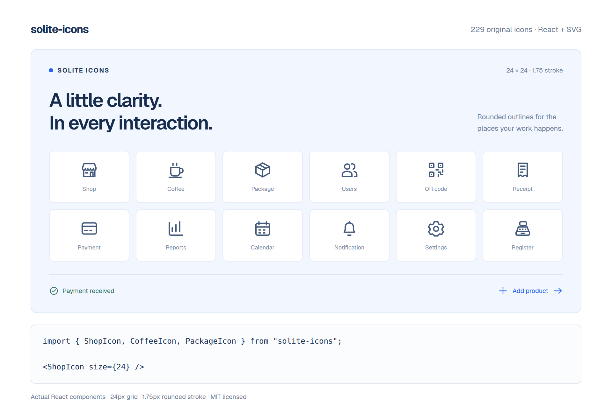

# Solite Icons

229 original SVG outline icons for dashboards, point of sale, cafés, restaurants, retail, payments, and everyday app controls.

Every icon uses a 24 × 24 grid, a 1.75px stroke, rounded caps and joins, and `currentColor`. Use React components or the SVG files directly. No stylesheet, icon font, or external icon service is required.



## Install from GitHub

The package is available from this repository. It has not been published to npm.

```sh
npm install github:Nikola-Limpet/solite-icons#main
# or
pnpm add github:Nikola-Limpet/solite-icons#main
# or
bun add github:Nikola-Limpet/solite-icons#main
```

Keep the resulting lockfile. For a reproducible version, replace `main` with a commit SHA. The repository includes the built package, so installation does not run a build in your project.

React components need React 18.2 or React 19. Install React if your project does not already use it. React is an optional peer dependency, so projects using only SVGs or raw geometry do not need it.

## React: import an icon by name

```tsx
import { HomeIcon, PackageIcon, ShopIcon } from "solite-icons";

export function Navigation() {
  return (
    <nav>
      <a href="/">
        <HomeIcon size={20} /> Home
      </a>
      <a href="/shops">
        <ShopIcon size={20} /> Shops
      </a>
      <a href="/packages">
        <PackageIcon size={20} /> Packages
      </a>
    </nav>
  );
}
```

Named imports support tree shaking in production bundlers. You can also import a single module:

```tsx
import CashRegisterIcon from "solite-icons/icons/cash-register";

<CashRegisterIcon size={24} />;
```

Icon file names use kebab-case. Component names use PascalCase followed by `Icon`: `cash-register` becomes `CashRegisterIcon`, `qr-code` becomes `QrCodeIcon`, and `user-add` becomes `UserAddIcon`.

Browse [the icon list](docs/icons.md) or open [catalog/index.html](catalog/index.html) from a clone or installed package. The catalog supports search, categories, size/stroke previews, dark backgrounds, React snippets, and SVG downloads. GitHub shows HTML source; download the repository and open the file in a browser to use the catalog.

## Styling

Icons inherit the surrounding text color. Pass SVG props, CSS classes, inline styles, or Tailwind classes:

```tsx
import { CheckCircleIcon, ShopIcon } from "solite-icons";

<ShopIcon size={20} color="#2563eb" strokeWidth={1.75} />;
<ShopIcon className="size-5 text-blue-600" />;
<CheckCircleIcon style={{ width: "1.25rem", height: "1.25rem", color: "green" }} />;
```

```css
.toolbar-icon {
  width: 20px;
  height: 20px;
  color: var(--text-muted);
  flex-shrink: 0;
}
```

```tsx
<ShopIcon className="toolbar-icon" />
```

| Prop                 | Default               | Purpose                                                                |
| -------------------- | --------------------- | ---------------------------------------------------------------------- |
| `size`               | `24`                  | SVG width and height, as a number or CSS length                        |
| `color`              | `currentColor`        | Stroke color                                                           |
| `strokeWidth`        | `1.75`                | Outline thickness in viewBox units                                     |
| `className`, `style` | none                  | CSS styling                                                            |
| `title`              | none                  | Accessible SVG title with a unique ID                                  |
| `aria-label`         | none                  | Accessible name without a visible title                                |
| `ref`                | none                  | Reference to the root `SVGSVGElement`                                  |
| Other SVG props      | standard SVG defaults | Such as `width`, `height`, `aria-hidden`, `data-*`, and event handlers |

Explicit `width` and `height` props override `size`. Use `size` or CSS when both dimensions should match. Keep the default outline thickness for visual consistency; use `strokeWidth` when a small control needs a heavier stroke.

## Accessibility

Icons are decorative by default: `aria-hidden="true"` and `focusable="false"`. Put an accessible name on an icon-only button:

```tsx
import { SettingsIcon } from "solite-icons";

<button type="button" aria-label="Open settings">
  <SettingsIcon size={20} />
</button>;
```

When the icon itself conveys information, give it a title or an ARIA label:

```tsx
import { PaymentCheckIcon } from "solite-icons";

<PaymentCheckIcon title="Payment received" />;
<PaymentCheckIcon aria-label="Payment received" />;
```

A title gets a unique `aria-labelledby` ID, including when multiple copies render. Do not add a separate icon title when adjacent text already names the same action.

## Dynamic names

For configuration-driven menus or names received at runtime, use the separate dynamic entry:

```tsx
import { SoliteIcon, type SoliteIconName } from "solite-icons/dynamic";

const iconName: SoliteIconName = "cash-register";

<SoliteIcon name={iconName} size={20} />;
```

This entry includes all 229 glyphs. Prefer named imports when the icons are known in code. Unknown names throw an error at runtime. Validate external strings before rendering:

```tsx
import { icons } from "solite-icons/data";
import { SoliteIcon, type SoliteIconName } from "solite-icons/dynamic";

function isIconName(value: string): value is SoliteIconName {
  return Object.hasOwn(icons, value);
}

function ConfiguredIcon({ value }: { value: string }) {
  return isIconName(value) ? <SoliteIcon name={value} /> : null;
}
```

## SVGs in any framework

Every icon is also a standalone file under `svg/`. Copy a file into your public assets directory and use it in HTML, Vue, Svelte, Laravel, or another framework:

```html

```

Use `alt=""` when the image is decorative. An SVG loaded through `` does not inherit the page's text color. Use inline SVG or the sprite when you need CSS-controlled stroke color.

Bundlers that support asset URLs can resolve the exported SVG path:

```tsx
// Vite asset URL example. Requires Vite's usual vite/client type declarations.
import shopUrl from "solite-icons/svg/shop.svg?url";

;
```

Your bundler's SVG loader controls whether an SVG import returns a URL, source text, or a component. Solite Icons does not install an SVG loader.

### SVG sprite

Copy `sprite.svg` into your public directory. Symbol IDs are prefixed with `solite-`:

```html
<svg width="20" height="20" viewBox="0 0 24 24" aria-hidden="true" style="color: #2563eb">
  <use href="/icons/sprite.svg#solite-shop"></use>
</svg>
```

### Raw geometry and names

The `/data` entry has no React imports:

```ts
import { icons, iconCategories, type SoliteIconName } from "solite-icons/data";

const names = Object.keys(icons);
const shopGeometry = icons.shop;
```

Each geometry node is `[tagName, attributes]`. Tags are limited to SVG drawing elements such as `path`, `rect`, and `circle`. `manifest.json` maps icon names to component names, files, and categories.

## CommonJS

```js
const { ShopIcon, CashRegisterIcon } = require("solite-icons");
const { SoliteIcon } = require("solite-icons/dynamic");
const { icons } = require("solite-icons/data");
```

## Moving from the app's `Uicons`

```tsx
// Before, inside Solite POS:
// import { Uicons } from "@/components/uicons";
// <Uicons name="shop" size={20} />

// Reusable named component:
import { ShopIcon } from "solite-icons";
<ShopIcon size={20} />;

// Or retain name-based rendering:
import { SoliteIcon } from "solite-icons/dynamic";
<SoliteIcon name="shop" size={20} />;
```

The geometry and default appearance are unchanged. The diagnostic DOM attribute is now `data-solite-icon`, replacing the app-local `data-uicon` attribute.

## Develop and add icons

Use Node.js 20.19 or newer and npm:

```sh
git clone https://github.com/Nikola-Limpet/solite-icons.git
cd solite-icons
npm ci
npm run build
npm test
npm run check
npm run format:check
```

Edit the original geometry in `src/definitions/`, then run `npm run build`. Keep the icon name unique, use the shared 24px grid, rounded joins/caps, and `currentColor`. Add the glyph to a group in `src/data.ts`. The build generates named React components, ESM/CommonJS modules, declarations, SVGs, the sprite, the manifest, and the catalog.

Commit the regenerated `src/icons/`, `src/index.ts`, `dist/`, `svg/`, `sprite.svg`, `manifest.json`, and `catalog/` files. `npm run check` detects stale or unexpected generated files. To remove an icon, remove its old generated files before rebuilding. Removing or renaming a public icon is a breaking API change.

The tests check all 229 export names, SVG geometry safety, accessible rendering, dynamic validation, CommonJS imports, and tree shaking. Keep the count assertion in sync when adding icons.

To inspect the package artifact:

```sh
npm pack --dry-run
```

The package is prepared for a future npm release. Before publishing, confirm the npm package name is available, update the version and changelog, rebuild, run all checks, and publish with your own npm account. No automatic publishing is configured.

## License and origin

[MIT](LICENSE). Copyright 2026 Nikola-Limpet.

These are original SVG drawings created for Solite POS, extracted from `Nikola-Limpet/hang-pos` at commit `07d7a83c9d2b98bb8449ea7b2a58ca055f8aecd1`. Their outline style follows the approved Solite admin design references. Brand logos and product photography are not part of this icon library.

## Documentation website

The `website/` directory contains the Next.js and [Fumadocs](https://fumadocs.dev) documentation app. Zod uses the same documentation framework. It includes MDX guides, documentation search, a live React playground, and a searchable browser of all 229 icons. Its dependencies are separate from the icon package.

```sh
npm ci
npm --prefix website ci
npm --prefix website run dev
```

Open `http://localhost:3000`. To build the static site:

```sh
npm --prefix website run build
```

Deploy `website/out/` on a static host. For GitHub Pages at `/solite-icons/`, build with `DOCS_BASE_PATH=/solite-icons`. For a root domain, leave the base path empty. Search runs in the browser using a generated index, so hosting does not require an API server.

Write guides in `website/content/docs/` and edit examples in `website/components/`. The site consumes the package at the pinned initial commit in `website/package.json`; update that revision when publishing new icons. See [website/README.md](website/README.md) for authoring, preview images, and deployment details.
